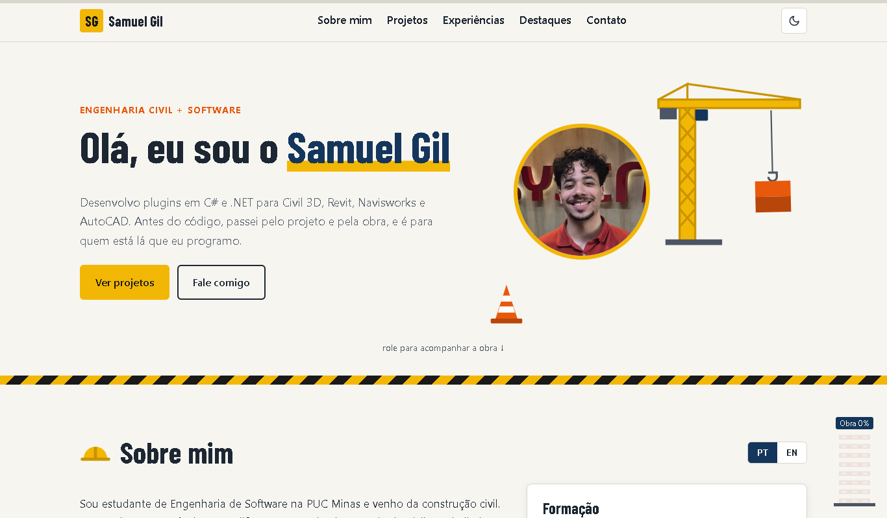
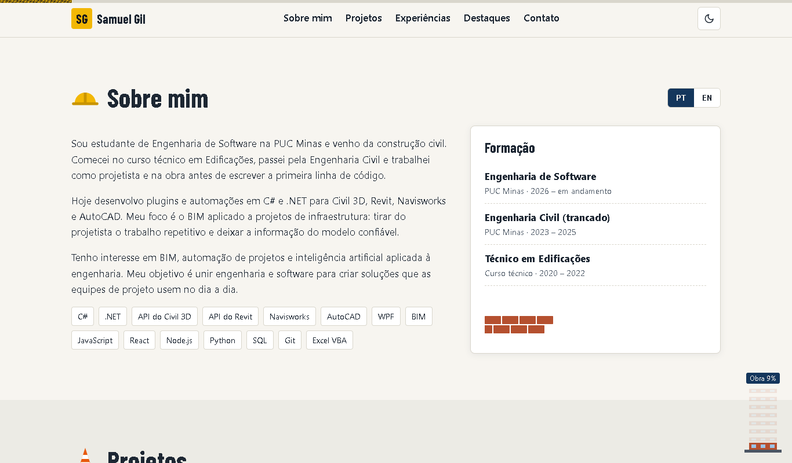
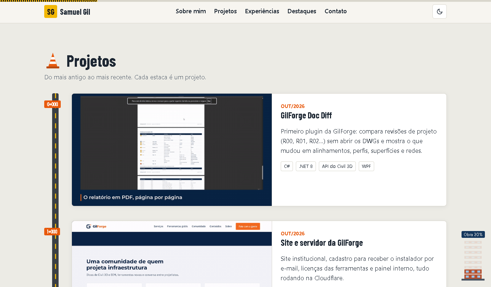
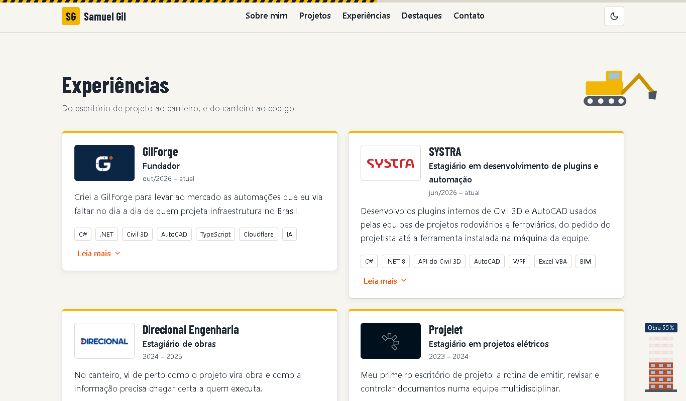
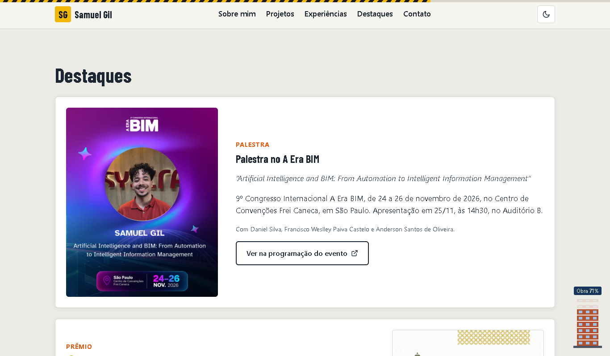
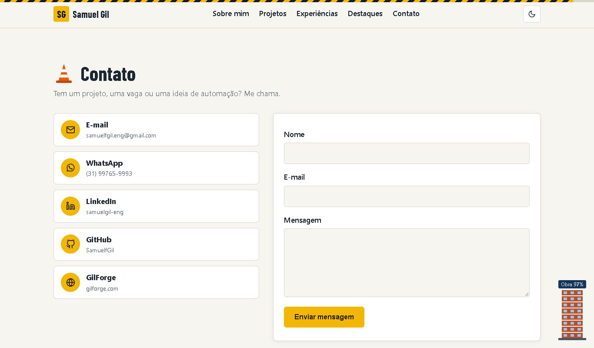
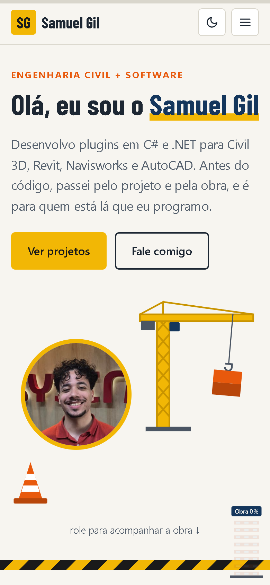

# 🏗️ Portfólio Samuel Gil 👨‍💻

> [!NOTE]
> Portfólio profissional de Samuel Gil, com foco em BIM, C# e .NET aplicados à engenharia civil. O visual lembra um canteiro de obras que vai se montando enquanto a página é rolada.

<table>
  <tr>
    <td width="800px">
      <div align="justify">
        Site feito no <b>Trabalho Prático 1</b> da disciplina <i>Desenvolvimento e Integração de Aplicações Web</i>, do curso de Engenharia de Software da PUC Minas. Ele conta a minha trajetória: comecei no técnico em Edificações, passei pela obra e hoje desenvolvo plugins para <b>Civil 3D, Revit, Navisworks e AutoCAD</b>. O site tem a seção <i>sobre mim</i> em português e inglês, uma linha do tempo de projetos, as experiências profissionais, os destaques e um formulário de contato que envia e-mail de verdade.
      </div>
    </td>
    <td>
      <div>
        
      </div>
    </td>
  </tr>
</table>

---

## 🚧 Status do Projeto

     

---

## 📚 Índice
- [Links Úteis](#-links-úteis)
- [Sobre o Projeto](#-sobre-o-projeto)
- [Funcionalidades Principais](#-funcionalidades-principais)
- [Tecnologias Utilizadas](#-tecnologias-utilizadas)
- [Arquitetura](#-arquitetura)
- [Instalação e Execução](#-instalação-e-execução)
  - [Pré-requisitos](#pré-requisitos)
  - [Variáveis de Ambiente](#-variáveis-de-ambiente)
  - [Instalação de Dependências](#-instalação-de-dependências)
  - [Como Executar a Aplicação](#-como-executar-a-aplicação)
- [Deploy](#-deploy)
- [Estrutura de Pastas](#-estrutura-de-pastas)
- [Demonstração](#-demonstração)
- [Testes](#-testes)
- [Documentações utilizadas](#-documentações-utilizadas)
- [Autores](#-autores)
- [Agradecimentos](#-agradecimentos)
- [Licença](#-licença)

---

## 🔗 Links Úteis
* 🌐 **Demo Online:** [samuelgil.gilforge.com](https://samuelgil.gilforge.com)
  > 💻 **Descrição:** site publicado na nuvem (Cloudflare Workers, plano gratuito).
* 🎨 **Wireframes (Figma):** [Portfólio Samuel Gil - Wireframes](https://www.figma.com/design/CHjBqQvWvJRPoym0j9CEaM)
  > 📐 **Descrição:** wireframes de baixa fidelidade das versões desktop (1440 px) e mobile (390 px), com todas as seções da página.
* 💼 **LinkedIn:** [linkedin.com/in/samuelgil-eng](https://www.linkedin.com/in/samuelgil-eng/)

---

## 📝 Sobre o Projeto

Eu queria um portfólio que fizesse sentido para quem trabalha com engenharia civil. Venho do técnico em Edificações, passei pela Engenharia Civil, trabalhei em escritório de projeto e na obra, e hoje desenvolvo plugins em C# e .NET para softwares BIM. O site conta essa história.

O visual imita uma obra:
- a barra do topo é uma fita zebrada que mostra quanto da página já foi lido;
- um prédio no canto da tela ganha andares conforme a rolagem;
- a linha do tempo de projetos é uma estrada com estacas (0+000, 1+000...);
- guindaste, cones, capacete, tijolos e escavadeira vão aparecendo ao longo da página.

Uso o site como portfólio para vagas e contatos profissionais na área de BIM e infraestrutura.

---

## ✨ Funcionalidades Principais

- 🧭 **Menu de navegação:** cabeçalho fixo com links para cada seção. No celular, o menu abre num botão.
- 🌐 **Sobre mim em português e inglês:** os botões PT e EN trocam o texto, a formação e as habilidades.
- 🛣️ **Linha do tempo de projetos:** do mais antigo ao mais recente. Cada projeto tem GIF ou imagem funcionando, as tecnologias usadas e o link do projeto publicado.
- 🏢 **Experiências:** cartões com a logo da empresa, o cargo, o período, um resumo e o botão **Leia mais** com os detalhes.
- 🏆 **Destaques:** o prêmio de Destaque Acadêmico (com código para conferir no verificador da PUC Minas) e a palestra no 9º Congresso A Era BIM.
- ✉️ **Contato:** ícones clicáveis (e-mail, WhatsApp, LinkedIn, GitHub e site) e um formulário com validação que envia e-mail pelo back-end.
- 🌓 **Tema claro e escuro:** segue o tema do sistema e pode ser trocado no botão do cabeçalho.
- 📱 **Responsivo:** testado em 1366 px e em 390 px (celular), sem rolagem horizontal.

---

## 🛠 Tecnologias Utilizadas

### 💻 Front-end

* **Biblioteca:** React 19.3.1
* **Linguagem:** JavaScript com JSX
* **Estilização:** CSS puro com variáveis de cor (`src/styles/global.css`)
* **Animações:** Framer Motion 14.14.0
* **Formulário e validação:** React Hook Form 7.92.0
* **Ícones:** React Icons 5.7.0
* **Build Tool:** Vite 8.3.8
* **Lint:** Oxlint

### 🖥️ Back-end

* **Runtime:** Cloudflare Workers (JavaScript)
* **Rota:** `POST /api/contato`, que valida os dados e envia o e-mail
* **E-mail:** binding `send_email` da Cloudflare, travado para um único destinatário

### ⚙️ Infraestrutura & DevOps

* **Cloud:** Cloudflare Workers com Static Assets (plano gratuito)
* **Domínio:** `samuelgil.gilforge.com`
* **CLI de deploy:** Wrangler 4.166.0

### 📦 Dependências

| Pacote | Tipo | Para que serve |
| :--- | :---: | :--- |
| `react`, `react-dom` | produção | interface |
| `framer-motion` | produção | animações ao rolar a página |
| `react-hook-form` | produção | estado e validação do formulário |
| `react-icons` | produção | ícones (Feather e Font Awesome) |
| `vite`, `@vitejs/plugin-react` | desenvolvimento | servidor local e build |
| `wrangler` | desenvolvimento | rodar o Worker localmente e publicar |
| `oxlint` | desenvolvimento | análise do código |

---

## 🏗 Arquitetura

O site é uma **SPA de uma página só**. A navegação é feita por âncoras (`#sobre`, `#projetos`...). O conteúdo fica separado da interface:

- **`src/data/conteudo.js`**: todos os textos, projetos e experiências. Para atualizar o site, quase sempre basta editar esse arquivo.
- **`src/sections/`**: um componente para cada seção da página (Início, Sobre, Projetos, Experiências, Destaques e Contato).
- **`src/components/`**: peças reaproveitadas (cabeçalho, rodapé e animação de entrada) e os desenhos de obra em SVG (`obra/`).
- **`worker/index.js`**: o back-end. Ele entrega os arquivos do site e responde a `POST /api/contato`.

**Fluxo do formulário de contato:**

```
Navegador ──POST /api/contato (JSON)──▶ Cloudflare Worker ──valida──▶ send_email ──▶ caixa de entrada
          ◀──── { ok: true } ou erro 400/500
```

**Decisões:**

- **Front e back no mesmo domínio:** o Worker serve o site e a API, então não foi preciso configurar CORS.
- **Validação nos dois lados:** o React Hook Form valida na tela para dar retorno rápido, e o Worker valida de novo, porque qualquer pessoa pode chamar a API direto.
- **Destinatário travado:** o binding de e-mail só envia para um endereço, então a API não pode ser usada para mandar spam para outras pessoas.
- **Sem banco de dados:** o site não guarda nada. A mensagem vai direto por e-mail.

---

## 🔧 Instalação e Execução

### Pré-requisitos

* **Node.js:** 20.19 ou superior (testado com o Node 24)
* **Gerenciador de pacotes:** npm
* **Conta na Cloudflare:** só para publicar. Para rodar localmente, não precisa.

### 🔑 Variáveis de Ambiente

O projeto não usa arquivo `.env`. As configurações do back-end ficam em `wrangler.jsonc`:

| Variável | Exemplo | Descrição |
| :--- | :--- | :--- |
| `EMAIL_DESTINO` | `samuelfgil.eng@gmail.com` | quem recebe as mensagens do formulário |
| `EMAIL_REMETENTE` | `portfolio@gilforge.com` | endereço que aparece como remetente |

### 📦 Instalação de Dependências

```bash
git clone https://github.com/SamuelfGil/portfolio-samuel-gil.git
cd portfolio-samuel-gil
npm install
```

### ⚡ Como Executar a Aplicação

**Só o front-end (mais rápido para mexer no visual):**

```bash
npm run dev
```

Abra `http://localhost:5173`. Nesse modo o formulário não envia, porque precisa do back-end rodando junto (veja o próximo comando).

**Front-end e back-end juntos (igual à produção):**

```bash
npm run worker
```

Abra `http://localhost:8787`. Localmente o e-mail não é enviado de verdade: o Wrangler mostra no terminal o e-mail que seria enviado.

---

## 🚀 Deploy

```bash
npx wrangler login   # só na primeira vez
npm run deploy       # vite build + wrangler deploy
```

O build gera a pasta `dist/`. Depois o Wrangler publica os arquivos dessa pasta junto com o `worker/index.js`, no domínio configurado em `wrangler.jsonc`.

---

## 📂 Estrutura de Pastas

```
.
├── README.md                 # 📘 Este arquivo.
├── LICENSE                   # ⚖️ Licença MIT.
├── index.html                # 🧱 HTML base onde o React é montado.
├── package.json              # 📦 Dependências e scripts.
├── vite.config.js            # ⚙️ Configuração do Vite (proxy de /api para o Worker local).
├── wrangler.jsonc            # ☁️ Configuração do Cloudflare Worker (domínio, e-mail e arquivos).
├── .oxlintrc.json            # ✨ Regras do lint.
│
├── /docs
│   └── /images               # 🖼️ Prints usados neste README.
│
├── /public                   # 📂 Arquivos estáticos servidos como estão.
│   ├── favicon.svg
│   ├── /img                  # 🖼️ Foto, certificado e cartaz da palestra.
│   ├── /logos                # 🏢 Logos das empresas das experiências.
│   └── /projetos             # 🎞️ GIFs e imagens dos projetos.
│
├── /src                      # 📂 Código-fonte React
│   ├── main.jsx              # 🚪 Ponto de entrada.
│   ├── App.jsx               # 🧩 Monta a página e controla o tema claro/escuro.
│   ├── /data
│   │   └── conteudo.js       # 📝 Todo o conteúdo do site.
│   ├── /sections             # 📄 Seções da página.
│   │   ├── Inicio.jsx
│   │   ├── Sobre.jsx
│   │   ├── Projetos.jsx
│   │   ├── Experiencias.jsx
│   │   ├── Destaques.jsx
│   │   └── Contato.jsx
│   ├── /components           # 🧱 Componentes reutilizáveis.
│   │   ├── Cabecalho.jsx
│   │   ├── Rodape.jsx
│   │   ├── Aparecer.jsx      # ✨ Animação de entrada ao rolar.
│   │   └── /obra             # 🏗️ Guindaste, cone, capacete, tijolos, escavadeira e prédio.
│   └── /styles
│       └── global.css        # 🎨 Cores, layout e responsividade.
│
└── /worker
    └── index.js              # 🖥️ Back-end: serve o site e a rota POST /api/contato.
```

---

## 🎥 Demonstração

### 🌐 Aplicação Web

| Tela | Captura de Tela |
| :---: | :---: |
| **Início** | **Sobre mim (PT/EN)** |
|  |  |
| **Projetos (linha do tempo)** | **Experiências** |
|  |  |
| **Destaques** | **Contato** |
|  |  |

### 📱 Celular



### 💻 Exemplo da API

```bash
curl -X POST https://samuelgil.gilforge.com/api/contato \
     -H "Content-Type: application/json" \
     -d '{"nome":"Maria","email":"maria@exemplo.com","mensagem":"Olá, vi seu portfólio!"}'
```

**Saída esperada:**
```json
{ "ok": true }
```

**Com dados inválidos (status 400):**
```json
{ "ok": false, "erros": ["nome", "email", "mensagem"] }
```

---

## 🧪 Testes

O projeto não tem testes automatizados. Conferi manualmente:

- formulário com campos vazios, e-mail inválido e mensagem curta (validação no front e no back);
- envio real de mensagem pelo site publicado;
- visual em 1366 px e em 390 px, nos temas claro e escuro;
- console do navegador sem erros.

Para checar o código:

```bash
npm run lint
```

---

## 🔗 Documentações utilizadas

* 📖 [Documentação oficial do **React**](https://react.dev/reference/react)
* 📖 [Guia de configuração do **Vite**](https://vite.dev/config/)
* 📖 [**Framer Motion**: animações ao rolar a página](https://motion.dev/docs/react-scroll-animations)
* 📖 [**React Hook Form**](https://react-hook-form.com/get-started)
* 📖 [**Cloudflare Workers**: Static Assets](https://developers.cloudflare.com/workers/static-assets/)
* 📖 [**Cloudflare Email Service**: envio pelo Worker](https://developers.cloudflare.com/email-service/api/send-emails/workers-api/)

---

## 👥 Autores

| 👤 Nome | 🖼️ Foto | :octocat: GitHub | 💼 LinkedIn | 📤 Gmail |
|---------|----------|-----------------|-------------|-----------|
| Samuel Ferreira Gil | <div align="center"></div> | <div align="center"><a href="https://github.com/SamuelfGil"></a></div> | <div align="center"><a href="https://www.linkedin.com/in/samuelgil-eng/"></a></div> | <div align="center"><a href="mailto:samuelfgil.eng@gmail.com"></a></div> |

---

## 🙏 Agradecimentos

* [**Engenharia de Software PUC Minas**](https://www.instagram.com/engsoftwarepucminas/), pelo apoio e pela estrutura do curso.
* [**Prof. Dr. João Paulo Aramuni**](https://github.com/joaopauloaramuni), pela proposta do trabalho e pelo template deste README.

---

## 📄 Licença

Este projeto é distribuído sob a **[Licença MIT](./LICENSE)**.
